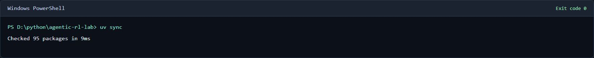
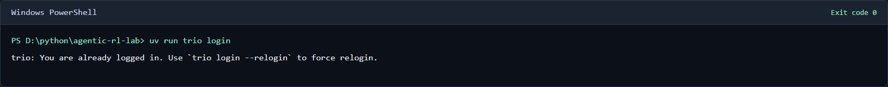
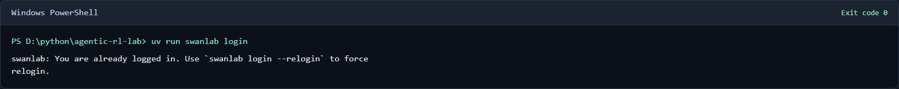
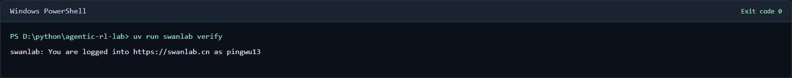
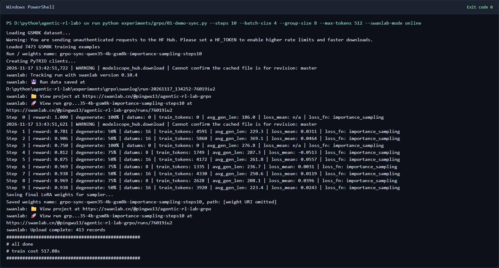
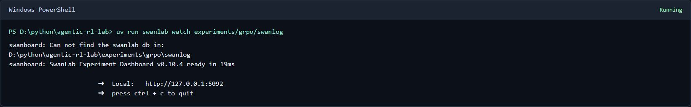
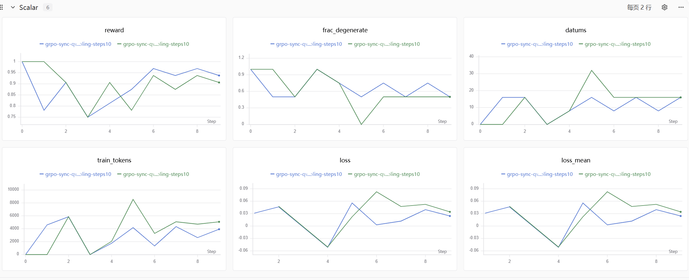
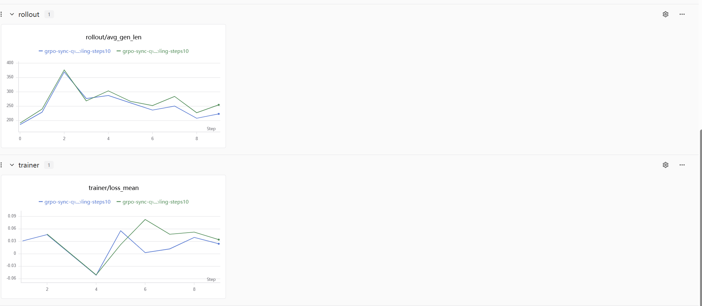

## task 1 学习笔记

#### 过程记录

```powershell
uv sync
```



```powershell
uv run trio login
```



```powershell
uv run swanlab login
```



```powershell
uv run swanlab verify
```



```powershell
uv run python experiments/grpo/01-demo-sync.py --steps 10 --batch-size 4 --group-size 8 --max-tokens 512 --swanlab-mode online
```



```powershell
uv run swanlab watch experiments/grpo/swanlog
```



#### 笔记

1. task1任务比较简单，创立环境，安装依赖，注册账号，跑通一个简单的demo。
2. 让codex调用命令跑了两次训练，两次训练的配置完全一样，但是有云端随机采样的因素影响，导致训练曲线并不完全一致，但整体趋势是基本趋于一致的。其实从曲线也看不出来什么有效信息，步数稍微有点少，整体还在一个区间内波动，勉强能看出来一个大的趋势。这大概就是GRPO的一个特点，不是一种稳定的趋势，而是因为采样的缘故，会上蹿下跳。
   
   
3. 简单vibe reading了一下demo代码，整个GRPO流程还是相对简单的（顺带了回顾了模型训练过程中的一些损失、反向传播细节，同预训练和SFT做了对比，对于整个过程有了更清楚的认识），GRPO其实就是用每组对于组内平均的偏差产生得分，用得分对后续交叉熵进行加权，最后影响到损失，从而拉高能提高正确答案的输出概率，降低导致错误答案的输出概率。做到最后，和SFT或者预训练基本一致。代码细节等待后续课程再加深学习。
4. 训练记录链接：https://swanlab.cn/@pingwu13/agentic-rl-lab-grpo/v1/oj0cqj/runs?utm_source=website_qr&utm_medium=qr_scan


