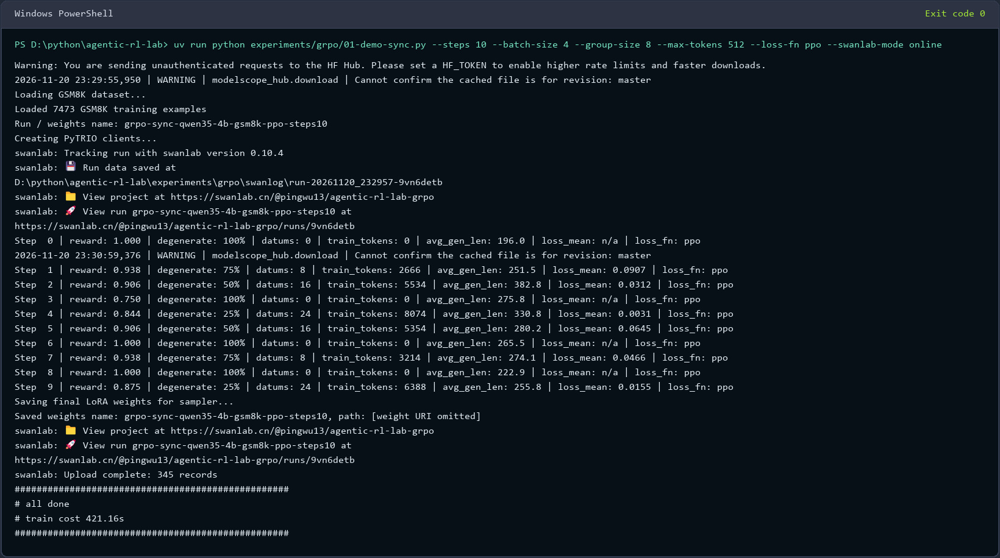
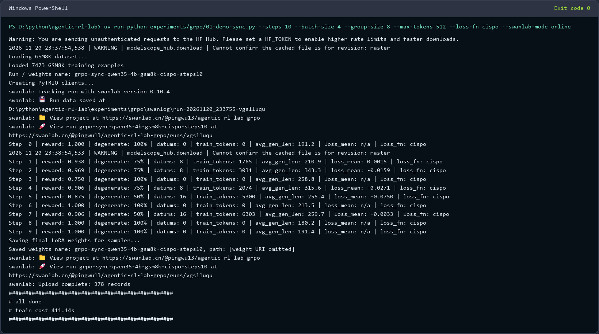
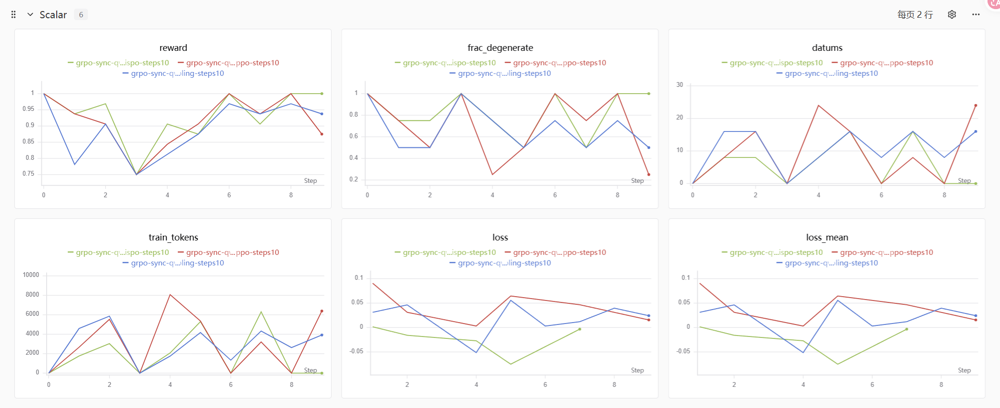
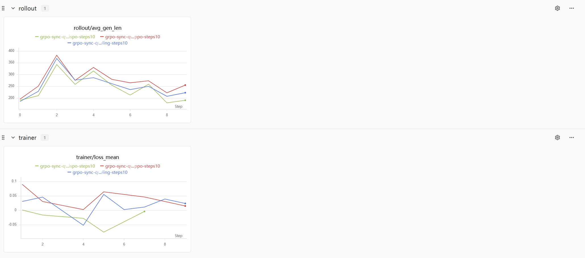

## task 2 学习笔记

#### 过程记录

```powershell
uv run python experiments/grpo/01-demo-sync.py --steps 10 --batch-size 4 --group-size 8 --max-tokens 512 --loss-fn ppo --swanlab-mode online
```



```powershell
uv run python experiments/grpo/01-demo-sync.py --steps 10 --batch-size 4 --group-size 8 --max-tokens 512 --loss-fn cispo --swanlab-mode online
```



#### 结果对比





1. 这次的内容我在上一次任务中已经基本进行过了，对于代码和GRPO的全流程已经走过一遍。整体的流程就是就是采样-打分-训练。三种不同loss的构造方式，其实主要是训练这一块的内容，GRPO的核心算法，是在前面的阶段。大道至简，越简单的，越好用。
